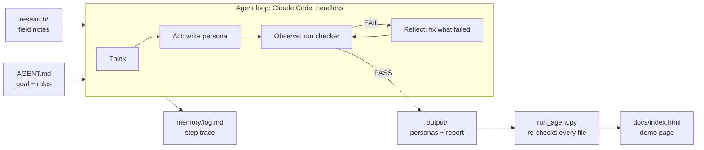

# JTBD Persona Agent

**An autonomous agent that turns qualitative field research into user personas, and checks its own work until it passes.**

[](https://github.com/javiersanzg/jtbd-persona-agent/actions/workflows/tests.yml)


**[Live demo of the last run](https://javiersanzg.github.io/jtbd-persona-agent/)**: the step-by-step trace, the three personas and the agent's conclusions, in one page. No install needed.

---

## Why

Writing a persona by hand takes weeks of synthesis. Asking a chatbot takes a minute, but you get a stereotype: invented facts, generic pains, and a list of app ideas nobody asked for.

This agent sits in between. It works only from your research, it has to show where every line comes from, and a deterministic checker decides when a persona is good enough. The model does the synthesis; the code keeps it honest.

## What it does

Given a folder of interview and observation notes, the agent:

1. **Extracts the patterns** (P1 to P5), each with a verbatim quote, a Job to Be Done and an insight.
2. **Writes one persona per point of the research line**: the extreme user at the hard end, the extreme user at the easy end, and a regular user.
3. **Runs the checker** on each persona, reads the verdict and fixes exactly what failed, up to three times.
4. **Writes a report** comparing the personas: shared jobs, what changes along the line, and which persona to design for first.
5. **Logs every step** (think, act, observe, reflect) as it goes, and the runner rebuilds the demo page.

## How it works



| Part | Here |
|---|---|
| Goal | `AGENT.md`: a measurable brief with a clear end state and hard constraints |
| Brain | Claude (Sonnet) in Claude Code headless mode: it picks its own next step |
| Tools | read files, write to `output/` and `memory/`, run `check_persona.py`. No web access |
| Memory | `memory/log.md`, written by the agent during the run |

### The checker is the point

`check_persona.py` is plain Python with no model inside, so the agent cannot talk its way past it. A persona passes only if:

- every required section is present, in order
- all five research patterns are used
- a *Based on* list traces each section back to a pattern
- it proposes no solutions (research, not ideation); words inside quotation marks are the users' own and are left out of this check, so the agent is never pushed to edit a verbatim
- every detail that is not in the research is marked with `*`
- it fits on one page (600 words or fewer)

After the agent stops, `run_agent.py` runs the checker again on every file. The final verdict never depends on what the agent says about its own work.

## Quick start

Requires Python 3.10+ and [Claude Code](https://code.claude.com), logged in once with `claude`. No other dependencies.

```bash
git clone https://github.com/javiersanzg/jtbd-persona-agent.git
cd jtbd-persona-agent
python run_agent.py
```

```text
agent running (sonnet), log: runs/2026-11-22_2228/steps.jsonl
agent finished after 19 tool calls
PASS persona-1-hard-end.md (454 words) []
PASS persona-2-easy-end.md (436 words) []
PASS persona-3-regular.md (401 words) []
RESULT: PASS
```

Check a single persona, or rebuild the demo page from the last run:

```bash
python check_persona.py output/persona-1-hard-end.md
python build_demo.py
```

Use it on your own research: replace `research/field_notes.md` and the challenge paragraph in `AGENT.md`.

## Example output

From the last run (full text in [`output/`](output/) and on the [demo page](https://javiersanzg.github.io/jtbd-persona-agent/)):

> **Rafael, the restaurant owner:** *"Every week I asked: is there news? And every week: we are waiting for Iberdrola."*
> Hard end of the line: a 19-month file. Trust sits with one person (P2), forgotten photos turn doubt about one step into doubt about the whole job (P4), and the silence, not the wait, is what hurts (P1).

The agent's own conclusion: *across the line, the distance is not in the length of the wait but in how much the person knows about it.*

## Project structure

```text
AGENT.md            the goal and rules given to the agent
run_agent.py        starts the agent, records the run, re-checks the results, rebuilds the demo
check_persona.py    the deterministic quality checker (the agent's tool)
build_demo.py       renders docs/index.html from output/ and memory/
research/           input: interview and observation notes
output/             patterns, personas and report of the last run
memory/log.md       the agent's step log of the last run
runs/               a copy of every run's output and log
docs/               the demo page, served by GitHub Pages
tests/              unit tests for the checker
```

## Design decisions

- **A deterministic judge instead of a second model.** A model grading a model can be argued with; a script cannot. It also makes the loop cheap and reproducible.
- **Bounded autonomy.** Three fix attempts per persona, a fixed write scope and no web access keep cost and blast radius small.
- **Every step on the record.** The trace makes the run explainable to someone who was not there, which is what the demo page is for.
- **No solutions.** Personas are research artefacts. Ideas belong to a later step, so the checker rejects them.

## Background

Built for a design-thinking course at EDEM (Valencia), on a real challenge from a small electrical installation company: clients waiting for utility paperwork that can take from two weeks to two years. The company and staff names are changed, and the interview notes are simulated from real conversations with the company.

## License

[MIT](LICENSE). Icons by [Phosphor](https://phosphoricons.com) (MIT).
